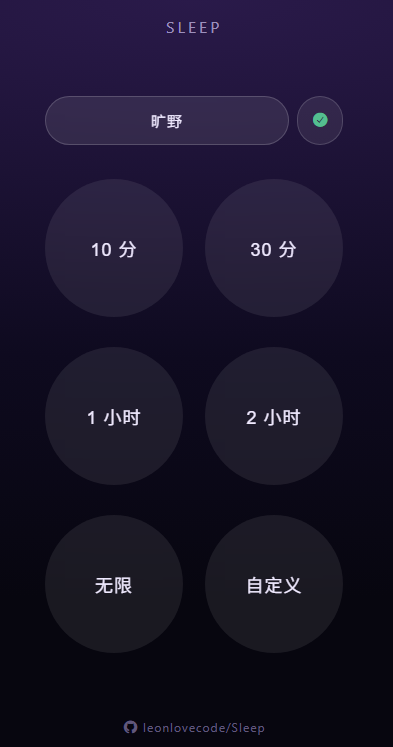

# Sleep · 助眠环境音



> 高质量环境音，无缝循环，倒计时停止，移动端熄屏持续播放，用于助眠。

## 特性

Sleep 追求纯粹 —— **高质量环境音，氛围感强，定时无缝循环，点开即用**，免费无广告。

- **无缝循环** —— 高质量环境音循环播放，相邻两段 5 秒等功率交叉淡变
- **多音源** —— 打雷下雨 / 倾盆大雨 / 淅沥下雨 / 海边礁石 / 夜晚蟋蟀青蛙 / 旷野
- **倒计时停止** —— 预设 10 分 / 30 分 / 1 小时 / 2 小时 / 无限 / 自定义（径向圆盘选择器）
- **可安装 / 可离线** —— PWA，断网可用

## 用法

**直接用**（任选其一）：

- 在线用：访问 [Sleep Pages](https://leonlovecode.github.io/Sleep/)（PWA，支持安装到主屏 / 离线使用）
- 离线用：下载 [Sleep.html](https://github.com/leonlovecode/Sleep/releases/latest/download/Sleep.html)，双击打开（音频 / 字体全内联）

**本地开发**：

```bash
npm install
npm run doctor         # 检查 Node 24、ffmpeg/ffprobe、libopus 与音频源
npm run test:countdown # 倒计时格式化自检
npm run build:audio    # 将 MP3 转为 Opus（build 时自动执行）
npm run dev            # 开发服务器（手机测试用输出的 Network 地址，同 WiFi），端口默认 5184，被占会自动跳
npm run build          # 产出单文件 dist/index.html（ogg/字体全内联，U 盘 file:// 直开）
npm run build:pwa      # 产出 PWA 多文件 dist/（给 GitHub Pages，含 service worker）
npm run preview        # 配合 build:pwa 本地预览 PWA
```

本地要求：Node.js 24.18.1（见 `.nvmrc`）与 PATH 中可用的 `ffmpeg`、`ffprobe`，且 FFmpeg 必须包含 `libopus` 编码器。

## 更新说明

项目更新记录见 [CHANGELOG.md](./CHANGELOG.md)。正式发布时，先将已验证的 `main` 提交推送到 GitHub，再推送同一提交的 `v*` 标签；Release 工作流会自动生成并附加 `Sleep.html`。

## 离线音频

- 单文件版：全部音频已内置，无需下载。
- PWA 版：打开页面不会自动下载音频；点击音源右侧云图标可下载以供离线使用。
- 在线播放未下载的音源时，应用会在后台尝试完整缓存；只有 Cache Storage 校验成功后才显示绿色勾选。

## 素材来源

`src/audio/` 下的高质量音频来自 **[Adobe Audition Sound Effects](https://www.adobe.com/products/audition/offers/AdobeAuditionDLCSFX.html)**

| 音频名 | 来源 |
| --- | --- |
| 01 - 打雷下雨.mp3 | `Weather\Weather Ambience Heavy Rain Thunderstorm Thunder 01.wav` |
| 02 - 倾盆大雨.mp3 | `Weather\Weather Ambience Heavy Rain Downpour Splatty 01.wav` |
| 03 - 淅沥下雨.mp3 | `Weather\Weather Ambience Rain Drips Water Splatty 01.wav` |
| 04 - 海边礁石.mp3 | `Ambience_2\Ambience Ocean Shore 01.wav` |
| 05 - 夜晚蟋蟀青蛙.mp3 | `Ambience_2\Ambience Night Crickets And A Bullfrog 01.wav` |
| 06 - 旷野.mp3 | `Ambience_2\Ambience Wilderness 01.wav` |

图标来自 **[Font Awesome Free](https://fontawesome.com)** 的 `fa-bed` 图标。

## Credits

本项目基于 [HaujetZhao/Sleep](https://github.com/HaujetZhao/Sleep) (MIT License) 重构与优化。
